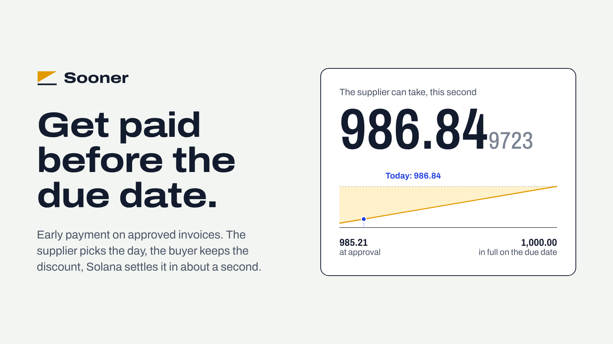
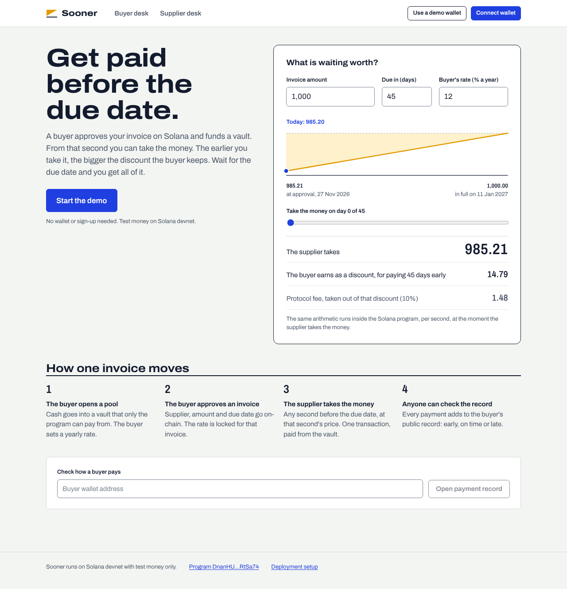
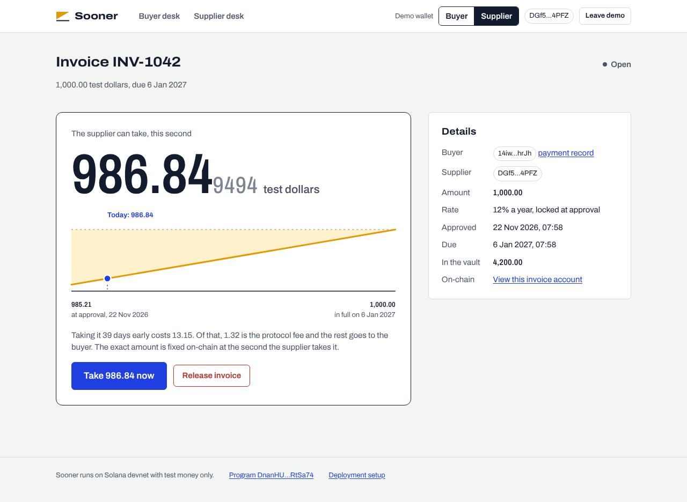
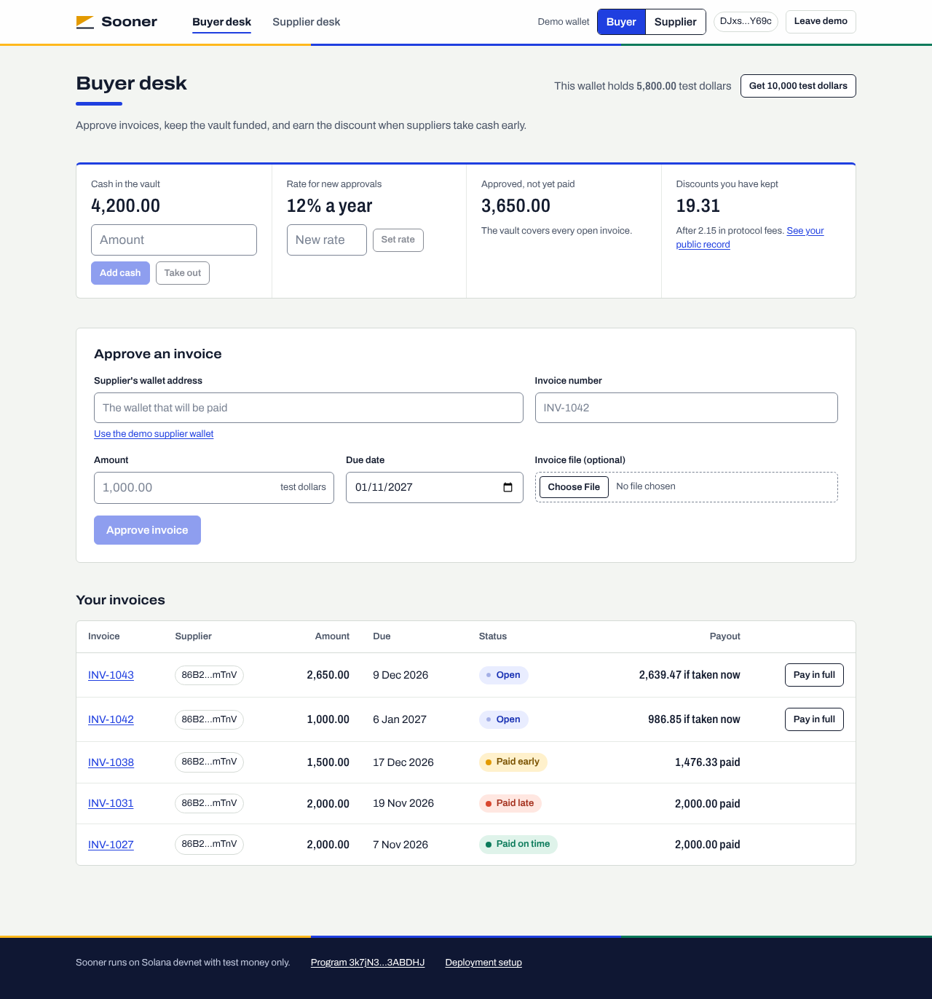
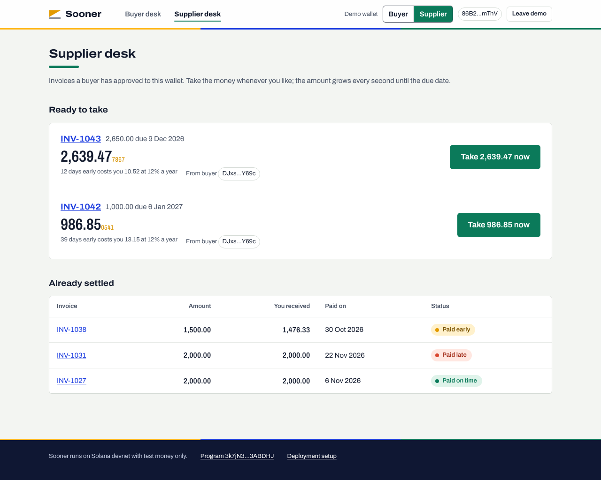
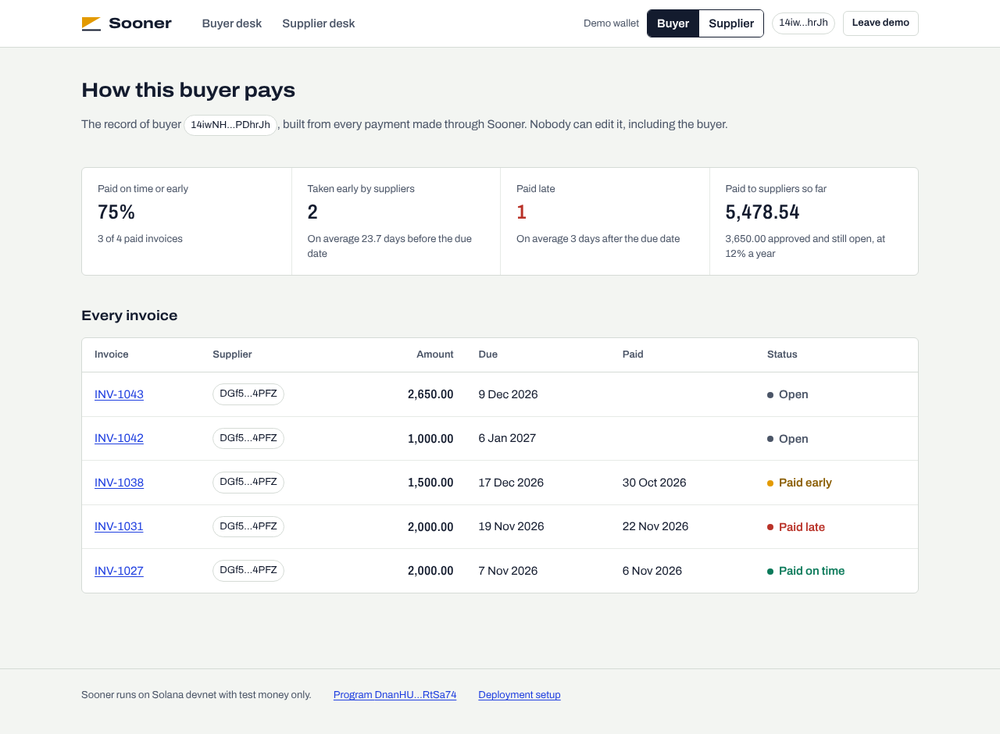
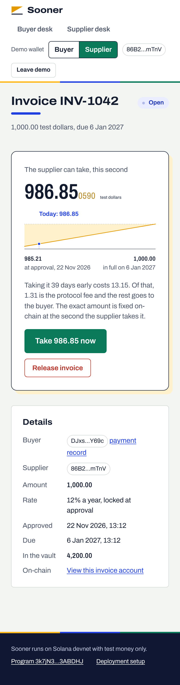
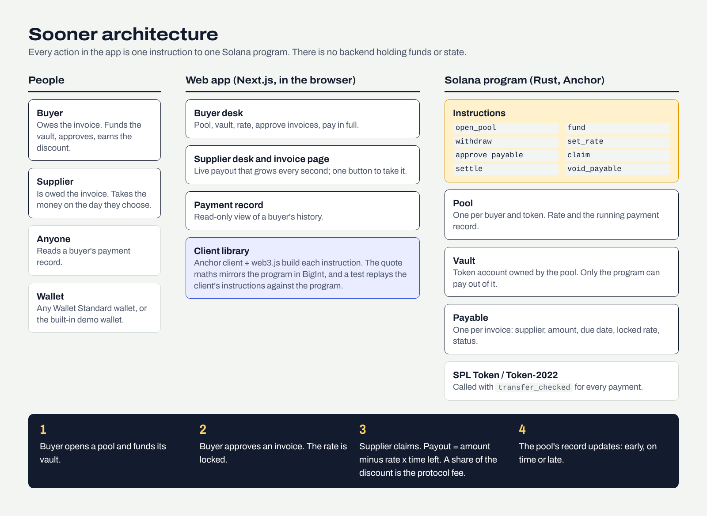
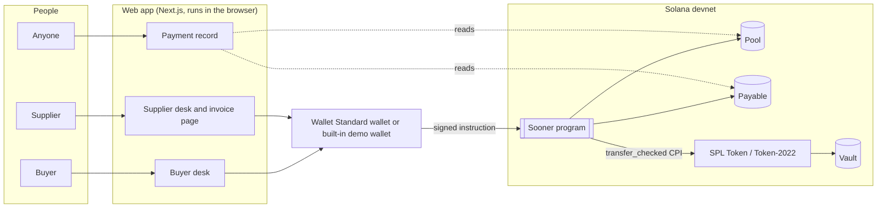
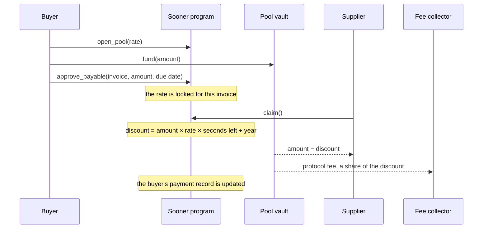

# Sooner

**Get paid before the due date.** Sooner is early payment on approved invoices, priced by the second and settled on Solana. A buyer approves an invoice and funds a vault. From that second the supplier can take the money: the earlier they take it, the bigger the discount the buyer keeps. On the due date they get all of it.



| | |
|---|---|
| Live app | **TODO: add the link after deploying** |
| Demo video | **TODO: add the link after recording** |
| Program (Solana devnet) | [`3k7jN3ufVfnp4w6UQDZkNmVimPKEU1pTcTXsxx3ABDHJ`](https://explorer.solana.com/address/3k7jN3ufVfnp4w6UQDZkNmVimPKEU1pTcTXsxx3ABDHJ?cluster=devnet) |
| Built for | Dev3pack Global Hackathon, November 2026. Tracks: Best App Overall on Solana, Best DeFi App on Solana |
| Licence | MIT |

## The problem

Suppliers wait to be paid, and waiting is expensive.

- Late payment touches roughly four in five companies in Western Europe, and about a quarter of invoices there are paid after the due date ([Atradius Payment Practices Barometer](https://group.atradius.com/knowledge-and-research/news/four-in-five-companies-in-western-europe-faced-with-late-payments)).
- In India, the Economic Survey 2025-26 put the money stuck in delayed payments to small businesses at ₹8.1 lakh crore ([Policy Circle](https://www.policycircle.org/industry/msme-financing-beyond-collaterals/)).

A fix already exists off-chain. It is called **dynamic discounting**: the buyer pays an approved invoice early from its own cash, and takes a discount that shrinks as the due date approaches ([Global Supply Chain Finance Forum](https://supplychainfinanceforum.org/techniques/dynamic-discounting/)). Banks sell it to large companies ([J.P. Morgan](https://www.jpmorgan.com/payments/solutions/trade-and-working-capital/payables-finance/dynamic-discounting)), and the C2FO marketplace says it has funded more than half a trillion dollars this way ([C2FO, March 2026](https://c2fo.com/newsroom/c2fo-surpasses-a-half-trillion-in-funding-milestone/)).

Those programs run through enterprise finance systems and bank rails. A small importer paying an overseas supplier in stablecoins has nothing like it. Sooner is that product as an open Solana program any two wallets can use.

## How it works

1. **The buyer opens a pool.** Cash goes into a vault that only the program can pay from. The buyer sets a yearly rate, for example 12%.
2. **The buyer approves an invoice.** Supplier wallet, amount and due date go on-chain. The pool's rate is locked for that invoice.
3. **The supplier takes the money** at any second they choose. The program computes the discount from the seconds left and pays from the vault in one transaction.
4. **The record updates.** Every payment adds to the buyer's public payment record: early, on time or late.

```
discount = amount × rate × seconds until due ÷ one year        (rounded down)
payout   = amount − discount
```

A 1,000.00 invoice due in 45 days, in a pool that offers 12% a year:

| The supplier takes it | Payout | Discount the buyer earns | Of which protocol fee (10%) |
|---|---|---|---|
| Today, 45 days early | 985.205480 | 14.794520 | 1.479452 |
| 30 days early | 990.136987 | 9.863013 | 0.986301 |
| 15 days early | 995.068494 | 4.931506 | 0.493150 |
| 1 day early | 999.671233 | 0.328767 | 0.032876 |
| On the due date | 1,000.000000 | 0 | 0 |

These are the exact figures the program produces; the first row is asserted in the tests.

## Why it is different

Most invoice projects on-chain are factoring: outside lenders buy the invoice. Sooner is buyer-funded, and that removes the three hard problems of factoring.

| | Tokenised invoice factoring | Sooner |
|---|---|---|
| Who pays early | Outside liquidity providers | The buyer who owes the money |
| Is the invoice real? | Needs an oracle or manual checks | The buyer approves its own invoice |
| What if the buyer never pays? | Lenders take the loss | Nobody lent anything |
| What the buyer gets | Nothing | A return on idle cash |
| Liquidity needed to start | A funded pool | None beyond the buyer's own payables |

It is not a loan. It is the buyer settling its own debt early at a price both sides can see.

## Screens

Rendered from this code with sample data. Replace with captures from the live deployment.

| | |
|---|---|
|  |  |
|  |  |
|  |  |

## Architecture







There is no backend that holds funds or state. The only server code is a small route that sends devnet SOL to new demo wallets so they can pay network fees.

## The program

One Anchor program, [`programs/sooner/src/lib.rs`](programs/sooner/src/lib.rs), about 800 lines including comments and unit tests.

### Accounts

| Account | Address seeds | What it holds |
|---|---|---|
| `Config` | `"config"` | Admin, fee collector, protocol fee, test dollar mint |
| `Pool` | `"pool"`, buyer, mint | The buyer's rate and running payment record |
| Vault | `"vault"`, pool | A token account owned by the pool. Only the program can pay out of it |
| `Payable` | `"payable"`, pool, invoice id | One invoice: supplier, amount, due date, locked rate, status |

The invoice id is the SHA-256 of the invoice file, or of the invoice number when no file is attached. Because it is part of the address, the same invoice cannot be approved twice in a pool.

### Instructions

| Instruction | Signed by | Effect |
|---|---|---|
| `open_pool(rate_bps)` | Buyer | Creates the pool and its vault |
| `fund(amount)` | Anyone | Moves tokens into the vault |
| `withdraw(amount)` | Buyer | Takes idle cash back out |
| `set_rate(rate_bps)` | Buyer | Sets the rate for future approvals |
| `approve_payable(invoice_id, amount, due_at, reference)` | Buyer | Creates the payable and locks the rate |
| `claim()` | Supplier | Pays amount minus discount from the vault, the fee to the collector, updates the record |
| `settle()` | Buyer | Pays the invoice in full from the vault |
| `void_payable()` | Supplier | Releases the buyer from an open invoice |
| `initialize(fee_bps)` | Deployer, once | Stores the protocol fee and creates the devnet test dollar |
| `set_config(fee_bps, treasury)` | Admin | Changes the fee or the fee collector |
| `demo_faucet()` | Anyone | Devnet only: mints 10,000 test dollars |

### What the program enforces

- Only the supplier named on an invoice can claim it. Only the buyer can withdraw, settle or change the rate.
- An invoice is paid once. A second claim or settlement fails.
- The rate on an invoice is the pool's rate at approval. Changing the pool's rate later does not touch it.
- The rate is capped at 50% a year, the protocol fee at 20% of a discount, and the due date at 366 days out.
- The discount is rounded down, so rounding favours the supplier, and it can never exceed the amount.
- Arithmetic on amounts is overflow-checked. All token movements use `transfer_checked`, so the program works with SPL Token and Token-2022 mints.
- Three events are emitted for indexers: `PayableApproved`, `PayablePaid`, `PayableVoided`.

### Tests

```
cargo test -p sooner
```

| Suite | What it covers |
|---|---|
| Unit tests in `lib.rs` (8) | The discount and fee arithmetic, including rounding and overflow |
| `tests/flows.rs` (14) | Every instruction, run in-process with `solana-program-test`: early claim, late claim, settlement, void, rate lock, access control, a short vault, Token-2022, and that every dollar is accounted for |
| `tests/js_client.rs` (1) | Replays the instructions built by the web client's own code against the program, so the TypeScript client and the Rust program cannot drift apart |

## The app

A Next.js app in [`app/`](app/). Every action is one instruction to the program.

- **Buyer desk** (`/buyer`): open a pool, add or take out cash, set the rate, approve invoices, pay in full.
- **Supplier desk** (`/supplier`): every invoice approved to your wallet, with a payout that grows each second and one button to take it.
- **Invoice page** (`/p/<address>`): a shareable link for one invoice, with the live amount and the payout chart.
- **Payment record** (`/record/<buyer>`): how a buyer pays, built from on-chain history.
- **Demo wallet**: one click creates a buyer wallet and a supplier wallet in the browser and funds them with test money, so anyone can try both sides without installing anything. Real wallets connect through the Wallet Standard.

The quote arithmetic in [`app/src/lib/math.ts`](app/src/lib/math.ts) mirrors the program in BigInt, so the number on the button matches the chain.

## Why Solana

- **Settlement in about a second, for a fraction of a cent.** That is what makes it worth discounting a 200 dollar invoice, and what lets a supplier in another country be paid at 2 a.m. on a Sunday.
- **One transaction does everything.** Price the time, pay the supplier, pay the fee and update the record, atomically. No intermediary holds the money in between.
- **Program-owned vaults.** The buyer pre-commits cash that only the program can release, so the supplier needs nobody's sign-off at the moment they claim.
- **A public record for free.** Each payment already lives on a public ledger, so a buyer's payment behaviour becomes something anyone can check.
- **Stablecoins are already there.** The program takes any SPL Token or Token-2022 mint.

## Business model

The protocol keeps a share of each discount, paid at the moment of the claim: 10% in this deployment, capped at 20% in the code. It only earns when a supplier chose to be paid early and a buyer earned a return.

Example: a buyer that pays 1,000,000 a month 30 days early at 12% a year earns about 9,863 in discounts. The protocol's share is about 986 a month from that one buyer.

## Run it

**Try the live app.** Open the link at the top, press *Start the demo*, then follow the buyer desk and supplier desk.

**Run the tests.** Needs stable Rust (tested with 1.97).

```
cargo test -p sooner
```

**Run the app locally.** Needs Node 20 or later.

```
cd app
npm install
npm run dev
```

**Deploy your own copy.** See [`docs/DEPLOY.md`](docs/DEPLOY.md). The program builds in Solana Playground with no local toolchain; the app deploys to Vercel from this repository with the root directory set to `app`.

## Repository layout

```
programs/sooner/src/lib.rs        the Solana program
programs/sooner/tests/            instruction-level tests and the client cross-check
idl/sooner.json                   the program's interface (Anchor IDL)
app/                              the web app (Next.js)
app/src/lib/program.ts            addresses, account readers, instruction builders
app/src/lib/math.ts               the quote arithmetic, mirroring the program
app/scripts/client-fixture.ts     writes the client's instructions for the cross-check test
docs/                             deployment guide, demo script, diagram, screens
```

## Tech stack

Rust, Anchor 0.29, SPL Token and Token-2022 (via `anchor-spl` token interface), `solana-program-test`; TypeScript, Next.js 14, React 18, `@solana/web3.js`, `@coral-xyz/anchor`, `@solana/spl-token`, Wallet Standard; Solana devnet; Solana Playground for the deployed build.

## Honest limits

- Devnet only, with test money. The program has not been audited.
- The vault is a budget, not a guarantee. An approved invoice above what the vault holds can only be claimed once the buyer adds cash. The app shows this to both sides.
- Amounts and wallet addresses are public, like everything on Solana.
- `initialize` can be called once, by whoever calls it first after deployment. A mainnet version would tie it to the upgrade authority.
- `demo_faucet` exists so people can try the app on devnet. It would be removed for mainnet.
- Demo wallets need a little devnet SOL for fees. Solana closed the public RPC faucet on devnet in 2026, so the deployment funds them from a small fee wallet. If that runs dry, the app shows a link to [faucet.solana.com](https://faucet.solana.com) instead.
- Mints with a transfer hook are not supported.
- The tests run the program natively. The on-chain build is produced separately in Solana Playground, where this code compiles without warnings.

## Roadmap

1. Outside funders: when a buyer's vault is short, a third party pays the supplier early and collects from the buyer at the due date.
2. A Solana Action (Blink) so a supplier can claim from a link in an email or chat.
3. Accounting exports for both sides.
4. Mainnet with USDC after an audit.

## How this was built

Built for the Dev3pack Global Hackathon (27 to 29 November 2026). Work on this repository began on 27 November 2026 at about 07:30 UTC, on the first day of the hackathon and a few hours before the kick-off session. Nothing here existed before that day, and no code was taken from another project.

Most of the code was written with an AI coding assistant (Claude, by Anthropic) under the team's direction. NoahAI was not used.

## Team

**TODO: fill this in.** Who you are, your university, what each person did, and why you chose this problem.

## Licence

[MIT](LICENSE)
